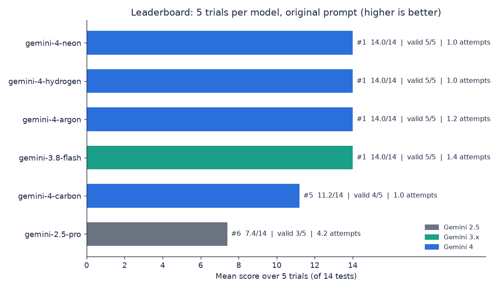
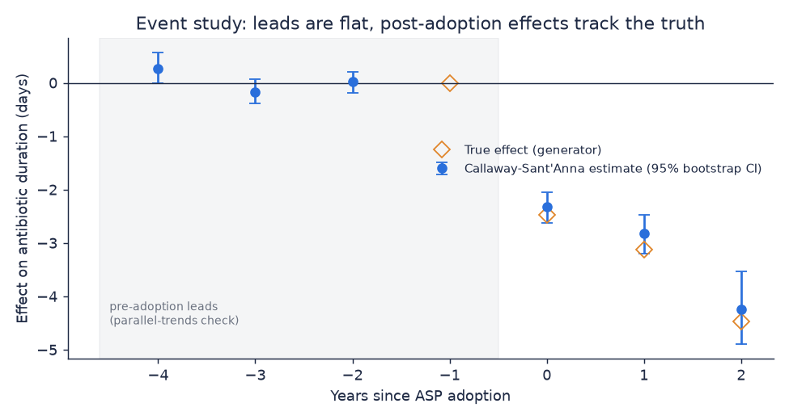
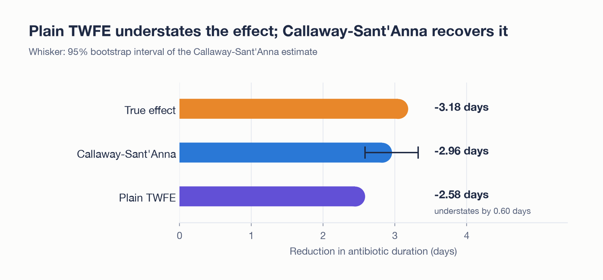
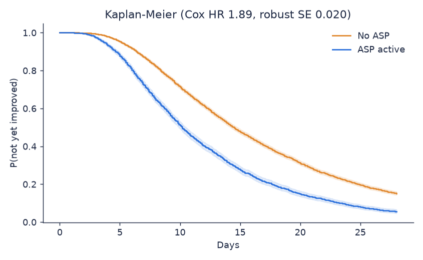
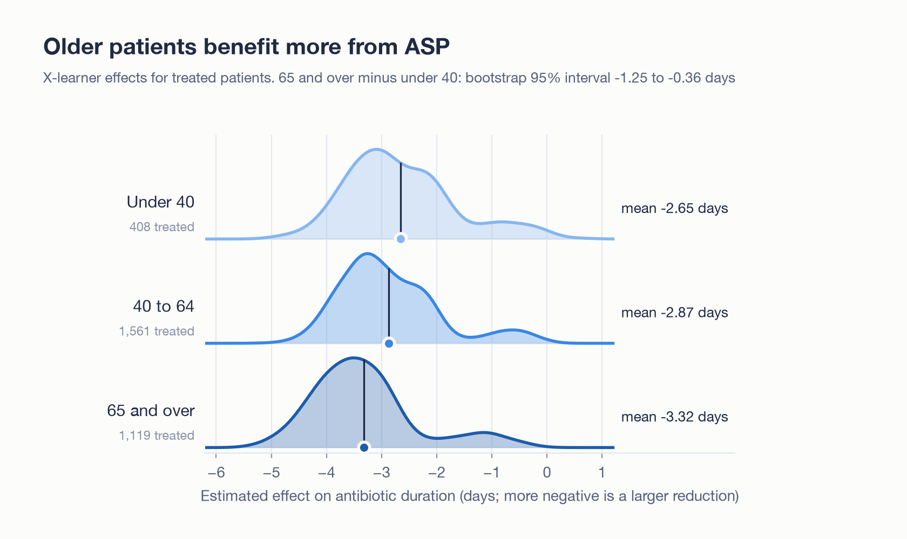
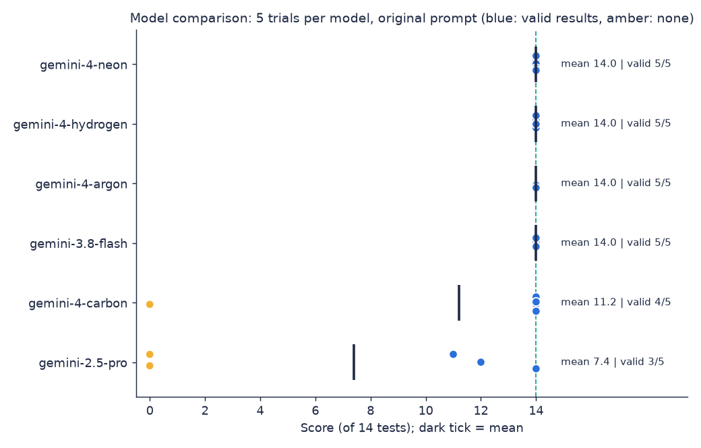
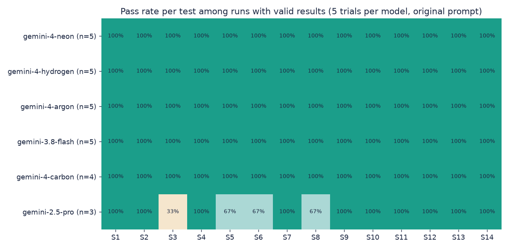
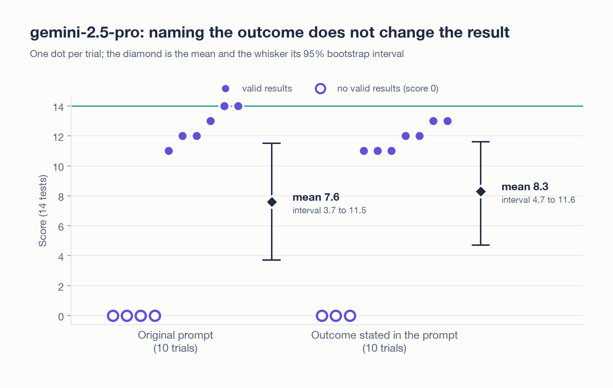
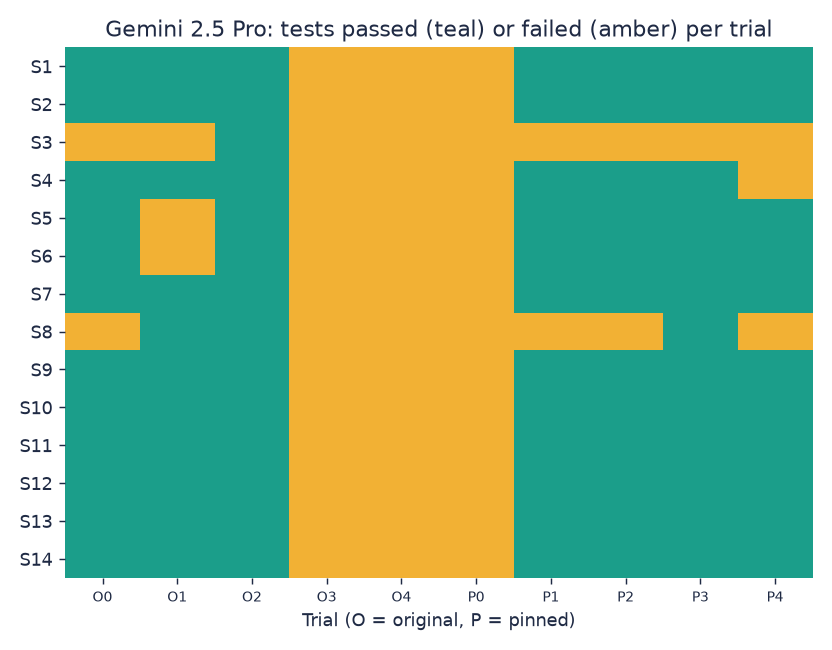

# Causal Inference Benchmark for LLM Agents on Antimicrobial Stewardship Programs: Survival Analysis with Kaplan-Meier and Cox Proportional Hazards, Staggered Difference-in-Differences with TWFE and Callaway-Sant'Anna, Heterogeneous Treatment Effects with T- and X-Learners on Gradient Boosting, Linear Mixed-Effects Models, a Seeded Synthetic Data Generator with Known Ground Truth, Behavioural Tests, and a Six-Model Gemini Comparison through the google-genai SDK, Tested with pytest and GitHub Actions, in Python

[](https://github.com/anandapurva55/antimicrobial-stewardship-causal-inference-llm-agent-benchmark/actions/workflows/ci.yml)
[](requirements.txt)


This repository measures how well six Gemini models (**gemini-2.5-pro**, **gemini-3.8-flash**, **gemini-4-argon**, **gemini-4-carbon**, **gemini-4-hydrogen** and **gemini-4-neon**) can act as a data scientist on a **causal inference** problem. The problem is to estimate the effect of an **Antimicrobial Stewardship Program** (**ASP**) on antibiotic use across 15 hospitals that adopted the program in different years. Each model receives a description of the data and a task, writes **Python** code, runs it, reads its own errors, and fixes the code. Its final results are then scored by 14 automated tests.

The data are **synthetic**, so the true effects are known and every estimate can be checked against the truth. An expert reference solution, called the **golden solution**, passes all 14 tests. All six models were evaluated with the same protocol.

| 6 | 14 | 4 of 6 | -2.96 | -2.58 | -3.18 |
|:---:|:---:|:---:|:---:|:---:|:---:|
| Gemini models compared | Automated tests | Models with a perfect 14/14 mean | Callaway-Sant'Anna ATT in days (golden solution) | Plain TWFE estimate in days (biased) | True ATT in days (from the generator) |



## Table of contents

1. [Problem and significance](#problem-and-significance)
2. [Quickstart](#quickstart)
3. [Dataset and ground truth](#dataset-and-ground-truth)
4. [Methods and algorithms](#methods-and-algorithms)
5. [Golden solution results](#golden-solution-results)
6. [The 14 tests](#the-14-tests)
7. [Agent evaluation protocol](#agent-evaluation-protocol)
8. [Model comparison](#model-comparison)
9. [Effect of stating the primary outcome](#effect-of-stating-the-primary-outcome)
10. [Testing and continuous integration](#testing-and-continuous-integration)
11. [Libraries and tools](#libraries-and-tools)
12. [Repository layout](#repository-layout)
13. [Reproducing the results](#reproducing-the-results)
14. [Limitations](#limitations)
15. [Security notes](#security-notes)
16. [License](#license)

## Problem and significance

**Antimicrobial resistance** is classified by the World Health Organization as one of the ten greatest global public health threats. An **Antimicrobial Stewardship Program** is a hospital policy that controls how antibiotics are prescribed: it restricts broad-spectrum drugs, shortens treatment courses and reduces infections such as *Clostridioides difficile*. Hospitals choose whether and when to adopt a program, and better-resourced hospitals tend to adopt earlier and to have better outcomes for other reasons. A simple comparison of hospitals with and without a program therefore mixes the effect of the program with the effect of the hospital. This mixing is called **confounding**.

A correct analysis needs four methods that depend on each other:

1. **Survival analysis**, because some patients have not yet improved when follow-up ends (**right-censored** patients) and cannot be treated as failures.
2. **Difference-in-differences**, because adoption is staggered across years and a before-and-after comparison against hospitals that never adopted is needed.
3. **Heterogeneous treatment effect estimation**, because the average effect can hide patient groups that benefit more.
4. **Mixed-effects modelling**, because patients in the same hospital are not independent of each other.

A task that needs all four, with one consistent primary outcome, tests whether a model can plan and carry out a multi-step analysis, not only run one method.

## Quickstart

```bash
git clone https://github.com/anandapurva55/antimicrobial-stewardship-causal-inference-llm-agent-benchmark
cd antimicrobial-stewardship-causal-inference-llm-agent-benchmark
python3.12 -m venv .venv
.venv/bin/pip install -r requirements.txt
.venv/bin/pip install -e .

.venv/bin/python -m asp_benchmark.golden                              # writes results/golden_results.json
.venv/bin/python -m asp_benchmark.scoring results/golden_results.json  # prints 14 tests and the score
```

To run an LLM agent, copy `.env.example` to `.env`, set `GEMINI_API_KEY`, and run `evaluation/run_agent.py` (see [Reproducing the results](#reproducing-the-results)).

## Dataset and ground truth

`src/asp_benchmark/data_generation.py` creates `data/asp_study_data.csv` (11,830 patient admissions, 22 columns) and `data/ground_truth.json` from a fixed random seed (42), so the data can be regenerated exactly.

| Property | Value |
|---|---|
| Hospitals, regions, years | 15 hospitals in 5 regions, 2017 to 2022 |
| Adoption | 5 hospitals adopt in 2020, 4 adopt in 2021, 6 never adopt. Larger hospitals adopt earlier |
| Primary outcome | `antibiotic_duration`, in days |
| True average effect of ASP on treated admissions | -3.18 days |
| Effect over time | Depends on the adoption cohort and grows with time since adoption. The 2020 cohort has effects of -2, -3 and -4 days in the adoption year and the two years after. The 2021 cohort has -2.5 days in both of its post-adoption years |
| Effect by age | 1.32 times larger for patients aged 65 and over |
| Hospital variation | A hospital-level random intercept with a standard deviation of 1.8 days. The intraclass correlation (ICC) of `antibiotic_duration` is 0.231 |
| A second outcome that does not cluster | `length_of_stay` has an ICC of 0.037, because it depends mostly on patient severity. It is included so that a model that picks the wrong outcome can be detected |
| Survival outcome | `time_to_improvement` is log-normal. ASP shortens it (generating log hazard ratio 0.35) |
| Censoring | 29.5% of patients are censored, by a 28-day follow-up limit or by independent loss to follow-up. Censoring does not depend on calendar year. It is lower under ASP (79% of treated patients reach improvement against 68% of untreated), because treated patients improve sooner |

Columns: `patient_id`, `hospital_id`, `hospital_size`, `region`, `ward`, `year`, `age`, `sex`, `age_group`, `comorbidity_score`, `immune_compromised`, `infection_type`, `severity_score`, `asp_adoption_year` (9999 means never), `asp_active` (1 when the year is at or after the adoption year), `time_to_improvement`, `event_observed` (0 means censored), `antibiotic_duration`, `length_of_stay`, `readmission_30d`, `c_diff_infection`, `mortality`.

## Methods and algorithms

The golden solution (`src/asp_benchmark/golden.py`, also available as `notebooks/golden_notebook.ipynb`) applies one method to each of the four objectives. All objectives that need an outcome use `antibiotic_duration`.

### 1. Survival analysis

* **Kaplan-Meier estimator** (**lifelines**) of the probability that a patient has not yet improved, separately for patients under ASP and not under ASP. Censored patients stay in the risk set until their censoring time.
* **Cox proportional hazards model** (**lifelines**) of `time_to_improvement` with `asp_active` and patient covariates (age, severity, comorbidity score, immunocompromise, sex, infection type and ICU ward). The model is fitted by maximising the **partial likelihood**. The standard error uses the **robust sandwich variance** with observations grouped by `hospital_id`, so patients from the same hospital are not counted as independent.
* **Proportional hazards check**: a test on the scaled **Schoenfeld residuals** (`proportional_hazard_test` with the rank time transform), which gives one p-value per covariate.

### 2. Difference-in-differences

* A **hospital-year panel** of mean `antibiotic_duration` (15 hospitals times 6 years, 90 rows).
* **Two-way fixed effects** (**TWFE**) regression (**linearmodels** `PanelOLS`) with hospital and year effects and standard errors clustered by hospital. With staggered adoption and effects that change over time, TWFE compares already-treated hospitals with newly treated ones, so it can be biased. It is reported as a comparison.
* **Callaway-Sant'Anna estimator**, the headline estimate. For each adoption cohort *g* and year *t*, it computes the change in mean outcome of the cohort from the year before adoption (*g* minus 1) to *t*, minus the same change in never-adopting hospitals. These cohort-year effects are averaged with the number of treated patients as weights, by years since adoption (the event study) and over all post-adoption years (the overall ATT).
* **Hospital-cluster bootstrap**: 1,000 resamples of hospitals within each group give 95% confidence intervals.
* **Pre-trend test**: the event study includes the pre-adoption years (up to four years before adoption). The **parallel-trends** check is the average of all pre-adoption coefficients, with its bootstrap confidence interval and p-value.

### 3. Heterogeneous treatment effects

* **T-learner**: two outcome models, one fitted on treated patients and one on untreated patients. The individual effect is the difference between their predictions.
* **X-learner**: uses the two outcome models to impute individual effects for each group, fits models of those imputed effects, and combines them with weights from a **propensity model** (a classifier that predicts treatment), clipped to the range 0.05 to 0.95.
* Base models are **scikit-learn** `HistGradientBoostingRegressor` (150 iterations, depth 4, learning rate 0.06) and `HistGradientBoostingClassifier`. Covariates include patient characteristics, hospital indicators and year, because treatment varies by hospital and year.
* A **patient-level bootstrap** (30 resamples) gives a confidence interval for the difference in mean effect between patients aged 65 and over and patients under 40.

### 4. Mixed-effects modelling

* A **linear mixed model** (**statsmodels** `MixedLM`) of `antibiotic_duration` with a random intercept for each hospital, fitted by **restricted maximum likelihood** (**REML**).
* **Intraclass correlation** (**ICC**): ICC = hospital variance / (hospital variance + residual variance).
* **Model comparison**: **Akaike information criterion** (**AIC**) of the mixed model, fitted by maximum likelihood, against an ordinary least squares model with the same fixed effects.

## Golden solution results

| Quantity | Golden solution | Reference |
|---|---|---|
| Cox hazard ratio for ASP | 1.89 (robust SE 0.0202, unclustered SE 0.0243) | |
| TWFE estimate | -2.58 days | Biased |
| Callaway-Sant'Anna ATT | -2.96 days (95% CI -3.32 to -2.58) | True value -3.18 |
| Pre-trend (average of all leads) | -0.02 days (p = 0.83, 95% CI -0.18 to 0.16) | Smallest detectable effect about 0.25 days |
| X-learner mean effect on treated patients | -3.00 days | True value -3.18 |
| Age 65 and over minus under 40, effect difference | -0.83 days (95% CI -1.25 to -0.36) | True difference about -0.9 |
| ICC of `antibiotic_duration` | 0.231 | |
| AIC, mixed model against OLS | 58,724 against 61,446 | Lower is better |



The event study shows flat pre-adoption coefficients, which supports the parallel-trends assumption, and post-adoption estimates that follow the true effects, including their growth with time since adoption. TWFE averages that growth away and underestimates the effect:



| Survival curves | Estimated effect by age group |
|---|---|
|  |  |

## The 14 tests

`src/asp_benchmark/scoring.py` scores a results file. Each test runs on its own, so one failure does not stop the others, and the score is the number of passed tests. Tests recompute reference values from `data/asp_study_data.csv` or compare against `data/ground_truth.json`. They do not accept self-declared flags. Three dataset checks (P1 to P3) are printed but not scored.

| ID | What is checked |
|---|---|
| S1 | The Cox hazard ratio is above 1 and within 15% of the recomputed value |
| S2 | The Cox standard error for ASP is between 0.5 and 2 times the recomputed hospital-clustered value |
| S3 | A dictionary of proportional-hazards p-values is reported. It includes `asp_active`, and every value is between 0 and 1 |
| S4 | The hospital-year panel has 90 unique rows and contains the true hospital-year means of `antibiotic_duration` |
| S5 | The event study has confidence intervals that contain the estimates and includes at least one pre-adoption coefficient |
| S6 | The pre-trend coefficient, p-value and confidence interval are consistent, and the data show no violation (p above 0.05, interval contains 0) |
| S7 | The TWFE estimate is within 0.3 days of the recomputed TWFE estimate |
| S8 | The staggered-adoption estimate is within 0.5 days of the true ATT |
| S9 | The individual-effect vector has one finite value per patient and a standard deviation above 0.3 |
| S10 | Patients aged 65 and over have a more negative mean effect than patients under 40, and the mean effect on treated patients is within 1.5 days of the truth |
| S11 | A confidence interval is reported for the difference in effect between older and younger patients |
| S12 | The reported ICC is within 50% of the ICC recomputed on `antibiotic_duration`. The message names the case where the value matches the `length_of_stay` ICC |
| S13 | The AIC of the mixed model is lower than the AIC of the model without random effects |
| S14 | The mixed-model ASP coefficient is within 1 day of the recomputed value and the random-effect variance is within 50% |

S2 checks that the reported standard error is plausible for a hospital-clustered Cox model. The exact value depends on the covariates, so S2 cannot prove that clustering was used. For that reason `evaluation/summarize_runs.py` also reports, without scoring it, whether the final generated script passes `cluster_col` to the Cox fit.

## Agent evaluation protocol

1. **Prompt.** `asp_benchmark.common.build_prompt` builds the prompt from the data: the dataset shape, column types, the first five rows and basic counts, the four objectives, the constraints, and the list of 17 required output variables with their meanings.
2. **Prompt conditions.** In the `original` condition, the mixed-model objective does not name the outcome. In the `pinned` condition, the prompt states that `antibiotic_duration` is the primary outcome for the difference-in-differences, treatment-effect and mixed-model objectives.
3. **Attempts.** The model writes **Python** code. The code runs in a separate process (`python -I`, 900-second limit, minimal environment without API keys). If it raises an error, the error text is sent back and the model writes corrected code. There are at most 5 attempts per trial.
4. **Model settings.** The model name is fixed, and there is no fallback to another model. The temperature is 0.7, and the random seed equals the trial number. Transient **API** errors are retried up to 5 times with increasing waiting time. These retries are not counted as attempts.
5. **Scoring.** The required outputs are saved as **JSON** and scored by `asp_benchmark.scoring`. A trial has *valid results* when the code ran and defined at least one required output. Trials without valid results score 0 and are included in all mean scores.
6. **Stored evidence.** For every trial, `results/runs/<model>/<prompt>/trial_<k>/` contains the prompt, each attempt's code and error output, the model name returned by the API, the results and the per-test scores.

## Model comparison

Six Gemini models were evaluated on the `original` prompt with 5 trials each (trials 0 to 4), so every model has the same number of trials. The models are `gemini-2.5-pro`, `gemini-3.8-flash`, and four models named `gemini-4-argon`, `gemini-4-carbon`, `gemini-4-hydrogen` and `gemini-4-neon`. Each trial stores the model it requested (`model_requested`) and the name the API returned (`model_reported`) in its `meta.json`, and the two match in all 58 trials. `python evaluation/list_models.py` lists the models your API key can use, and the [Gemini models documentation](https://ai.google.dev/gemini-api/docs/models) describes the model families.

| Rank | Model | Mean score (all trials) | Valid results | Mean score (valid trials) | Mean attempts | ICC test (S12) | Cox clustered (code check) |
|:---:|---|:---:|:---:|:---:|:---:|:---:|:---:|
| 1 (tie) | gemini-4-hydrogen | 14.0 | 5/5 | 14.0 | 1.0 | 5/5 | 5/5 |
| 1 (tie) | gemini-4-neon | 14.0 | 5/5 | 14.0 | 1.0 | 5/5 | 5/5 |
| 1 (tie) | gemini-4-argon | 14.0 | 5/5 | 14.0 | 1.2 | 5/5 | 5/5 |
| 1 (tie) | gemini-3.8-flash | 14.0 | 5/5 | 14.0 | 1.4 | 5/5 | 5/5 |
| 5 | gemini-4-carbon | 11.2 | 4/5 | 14.0 | 1.0 | 4/4 | 4/4 |
| 6 | gemini-2.5-pro | 7.4 | 3/5 | 12.3 | 4.2 | 3/3 | 3/3 |





Observations:

* Four models reach the maximum score in every trial, and they do so on the first or second attempt.
* `gemini-4-carbon` scores 14 in four trials. In the fifth, the code ran but defined none of the required output variables, so the score is 0.
* `gemini-2.5-pro` needs 4.2 attempts on average. Two of its five trials never produced working code within 5 attempts (errors such as misuse of the lifelines result objects, regression design matrices that are not full rank, event-time variable names in formulas, and an invalid `method` argument to `MixedLM.fit`).
* Across all 58 stored trials, no reported ICC matched the ICC of `length_of_stay`. Every ICC test failure is a missing output.

Trials beyond the first 5 were run for some models. They are not part of the comparison table above, and they give the same picture:

| Model | Prompt | Completed trials | Valid results | Mean score (all) | Mean score (valid) |
|---|---|:---:|:---:|:---:|:---:|
| gemini-4-argon | original | 10 | 10/10 | 14.0 | 14.0 |
| gemini-4-hydrogen | original | 9 | 9/9 | 14.0 | 14.0 |
| gemini-4-neon | original | 5 | 5/5 | 14.0 | 14.0 |
| gemini-3.8-flash | original | 8 | 8/8 | 14.0 | 14.0 |
| gemini-4-carbon | original | 6 | 5/6 | 10.5 | 12.6 |
| gemini-2.5-pro | original | 10 | 6/10 | 7.6 | 12.7 |
| gemini-2.5-pro | pinned | 10 | 7/10 | 8.3 | 11.9 |

Per-trial figures for `gemini-2.5-pro` under both prompts:



## Effect of stating the primary outcome

`gemini-2.5-pro` was run 10 times with each prompt. In the `original` prompt, the mixed-model objective does not name the outcome, so a model could reasonably choose `length_of_stay`. In the `pinned` prompt, the outcome is stated once.

| Prompt | Trials | Valid results | Mean score (all) | Mean score (valid) | Scores of valid trials |
|---|:---:|:---:|:---:|:---:|---|
| original | 10 | 6 | 7.6 | 12.7 | 11, 12, 12, 13, 14, 14 |
| pinned | 10 | 7 | 8.3 | 11.9 | 11, 11, 11, 12, 12, 13, 13 |

The difference between the prompts is small compared with the variation between trials. It comes mainly from how many trials produced working code. In both prompts, every valid trial passed the ICC test, so the prompt wording did not change which outcome was used.

The figure below shows the result of each test (rows S1 to S14) in each of the 20 trials (columns; O0 to O9 use the original prompt and P0 to P9 use the pinned prompt). Teal means the test passed and amber means it failed. A column that is entirely amber is a trial that produced no valid results. Row S3 (the proportional-hazards p-value dictionary) is amber in most trials of this model, because it did not return a dictionary that includes `asp_active`.



## Testing and continuous integration

The repository has two separate kinds of tests. The **14 scored tests** in `src/asp_benchmark/scoring.py` evaluate an analysis and are described in [The 14 tests](#the-14-tests). The **pytest tests** in `tests/` check that the benchmark itself works:

| File | What it checks |
|---|---|
| `tests/test_data.py` (3 tests) | The generator is deterministic for a fixed seed, the committed dataset matches it, and the design properties hold: 15 hospitals, 6 years, `asp_active` equal to year at or after adoption, and about 29.5% censoring |
| `tests/test_scoring.py` (5 tests) | The golden solution passes all 14 scored tests, a `length_of_stay` ICC is caught by the ICC test, a TWFE estimate reported as the staggered-adoption estimate is caught, missing outputs fail without stopping the other tests, and a proportional-hazards dictionary with only `asp_active` is accepted |
| `tests/test_agent.py` (7 tests) | Generated code runs in a separate process, errors and timeouts are returned as text, code fences are removed from model replies, the pinned prompt names the primary outcome while the original prompt does not, generated code does not receive the API key, and a failed client creation leaves no trial directory |

`pytest` runs the 15 tests in about 20 seconds. They need no API key and make no calls to the Gemini API.

**GitHub Actions** runs the same command on every push to `main` and on every pull request (`.github/workflows/ci.yml`). The workflow checks out the code, sets up Python 3.12 with a pip cache, installs `requirements.txt` and the package with `pip install -e .`, and runs `pytest -q`. The CI badge at the top of this README shows the result of the latest run.

## Libraries and tools

The project is written in Python. The table groups the libraries and tools by purpose.

| Purpose | Library or tool | Use in this project |
|---|---|---|
| Language | **Python** 3.12 | All code |
| Numerical computing | **NumPy** (`default_rng`) | Seeded data generation, bootstrap resampling, array computation |
| | **pandas** | Data handling, hospital-year panel construction |
| | **SciPy** | Normal distribution for bootstrap p-values |
| Statistical modelling | **lifelines** | Kaplan-Meier estimator, Cox proportional hazards with clustered standard errors, Schoenfeld-residual test |
| | **linearmodels** | Two-way fixed effects with `PanelOLS` and clustered standard errors |
| | **statsmodels** | Linear mixed model (`MixedLM`, REML and maximum likelihood), ordinary least squares, AIC |
| Machine learning | **scikit-learn** | Histogram gradient boosting regressors and classifier for the T- and X-learners |
| Visualisation | **matplotlib** | All figures in `docs/` |
| Language model access | **google-genai** | Gemini API client with chat sessions, a fixed model name and a seed |
| | **python-dotenv** | Loads `GEMINI_API_KEY` from `.env` |
| Execution and storage | **subprocess** (Python standard library) | Runs generated code in a separate process with a time limit |
| | **JSON** (data format) | Exchange of results between the agent runs and the tests (no pickle files) |
| Notebooks | **Jupyter**, **jupytext**, **nbconvert**, **nbformat**, **ipykernel** | Builds and runs the notebooks from the source scripts |
| Testing and automation | **pytest** | 15 tests for the data generator, the scoring and the code runner |
| | **GitHub Actions** | Continuous integration: runs `pytest` on every push to `main` and on every pull request (`.github/workflows/ci.yml`) |
| Packaging | **setuptools** with `pyproject.toml` | Makes `src/asp_benchmark` installable with `pip install -e .` |

## Repository layout

```
antimicrobial-stewardship-causal-inference-llm-agent-benchmark/
├── src/asp_benchmark/
│   ├── data_generation.py       # synthetic data generator, writes data/
│   ├── golden.py                # expert solution, source of the golden notebook
│   ├── scoring.py               # the 14 scored tests
│   ├── agent.py                 # Gemini agent: prompting, isolated code execution, scoring of one trial
│   ├── common.py                # required outputs, prompt builder, JSON read and write
│   └── paths.py                 # repository paths
├── evaluation/
│   ├── run_agent.py             # command line to run agent trials
│   ├── list_models.py           # lists the Gemini models available to your API key
│   ├── rescore_runs.py          # re-scores stored trials without calling the API
│   └── summarize_runs.py        # writes results/summary.json and results/comparison.md
├── scripts/
│   ├── make_figures.py          # writes the figures in docs/
│   ├── make_badges.py           # writes the badges in docs/images/badges/
│   └── build_notebooks.py       # regenerates the three notebooks
├── data/
│   ├── asp_study_data.csv       # 11,830 admissions x 22 columns
│   └── ground_truth.json        # true effects used to check estimates
├── notebooks/
│   ├── golden_notebook.ipynb    # golden solution with stored outputs
│   ├── unit_test_notebook.ipynb # scores a results file, with stored outputs
│   └── agent_notebook.ipynb     # runs one agent trial
├── results/
│   ├── golden_results.json      # outputs of the golden solution
│   ├── summary.json             # statistics for every set of trials
│   ├── comparison.md            # model comparison table
│   └── runs/                    # prompts, code, errors and scores for every trial
├── tests/                       # pytest tests for the generator, the scoring and the code runner
├── docs/                        # figures and badges used in this README
├── .github/workflows/ci.yml     # GitHub Actions: runs pytest on every push and pull request
├── pyproject.toml               # package definition and pytest settings
├── requirements.txt             # pinned dependencies
├── .env.example                 # template for GEMINI_API_KEY
├── SECURITY.md
└── LICENSE
```

## Reproducing the results

```bash
# Install
python3.12 -m venv .venv
.venv/bin/pip install -r requirements.txt
.venv/bin/pip install -e .

# Tests
.venv/bin/pytest

# Data and golden solution
.venv/bin/python -m asp_benchmark.data_generation
.venv/bin/python -m asp_benchmark.golden
.venv/bin/python -m asp_benchmark.scoring results/golden_results.json

# Agent trials (requires GEMINI_API_KEY in .env). `list_models.py` shows the model names your key can use.
.venv/bin/python evaluation/list_models.py
# Finished trials are skipped, so the command can be repeated.
.venv/bin/python evaluation/run_agent.py --model gemini-4-argon --condition original --trials 5
.venv/bin/python evaluation/run_agent.py --model gemini-2.5-pro --condition pinned --trials 10

# Summaries, figures and notebooks
.venv/bin/python evaluation/rescore_runs.py     # optional: re-score stored trials after changing the tests
.venv/bin/python evaluation/summarize_runs.py   # writes results/summary.json and results/comparison.md
.venv/bin/python scripts/make_figures.py
.venv/bin/python scripts/build_notebooks.py
```

`evaluation/run_agent.py` options: `--model` (any Gemini model name available to your key), `--condition` (`original` or `pinned`), `--trials`, `--start` (first trial number), `--temperature` (default 0.7), `--max-attempts` (default 5) and `--exec-timeout` (seconds, default 900).

## Limitations

* The model comparison uses 5 trials per model. This gives a clear separation between the weakest and strongest models, but not between models whose scores are close.
* Two tests were loosened after the first runs because they were stricter than the prompt. S2 originally required the Cox standard error to match one covariate set within 15%, and S3 originally required at least 5 covariates, which the prompt does not state. The stored trials were rescored with the final tests. The S3 change moves `gemini-3.8-flash` from 13 to 14 and therefore changes the ranking.
* The test suite has a ceiling. Four models reach 14 out of 14 in every trial, so the suite cannot rank them against each other. Harder objectives or a stricter set of tests would be needed to separate them.
* The data have two adoption cohorts. Effect differences that depend on more cohorts cannot be tested.
* The Cox standard error test (S2) checks plausibility, not clustering. The code check in `evaluation/summarize_runs.py` covers that point without scoring it.
* The pinned-outcome experiment was run for `gemini-2.5-pro` only.
* The four `gemini-4-*` names are model identifiers returned by the API. The API gives no description of how they differ.
* All data are synthetic. Results on this benchmark do not measure performance on real clinical data, which has missing values, measurement error and unknown confounding.
* LLM outputs vary between runs. The temperature is 0.7 and the seed is the trial number, but the API does not guarantee identical output for the same seed.

## Security notes

* Generated code runs in a separate process with a time limit and a minimal environment. Variables such as `GEMINI_API_KEY` are not passed to it. This is not a sandbox: the process can still read any file the user can read, including `.env`, and can use the network. Use a container or virtual machine to run code from models that are not trusted.
* Results are stored as JSON, and no pickle files are read.
* `.env` is excluded from version control. The stored trial logs contain prompts, generated code and error messages, and no API keys.
* To report a vulnerability, follow [SECURITY.md](SECURITY.md).

## License

MIT. See [LICENSE](LICENSE).
